# Documentación Técnica Proyecto 1 - RC2 - 202307716

## 1. Topología Completa

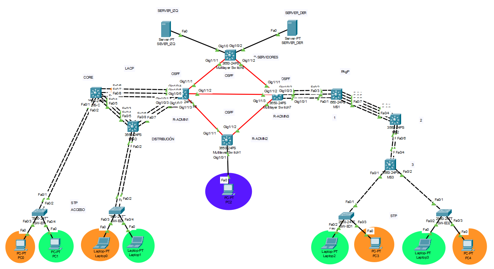

## 2. Cálculos de Subnetting (VLSM/FLSM)

### 2.1 VLSM

**Calculadora utilizada para realizar los cálculos de VLSM:**
[Calculadora VLSM](https://www.arcadio.gq/calculadora-subredes-vlsm.html)

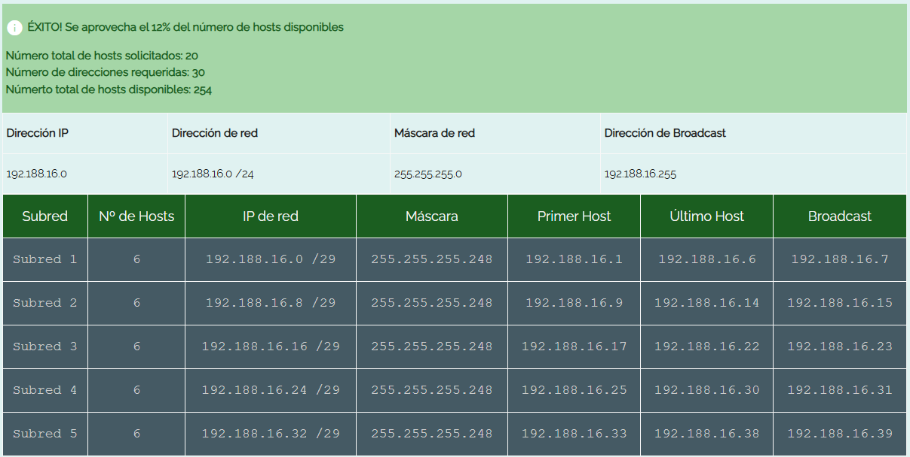

#### 2.1.1 IP de Red = 192.188.16.0 /24

| **VLAN**                           | **ID VLAN** | **No. de Hosts** | **IP de Red**     | **Máscara**     | **Wildcard** | **Primer Host** | **Último Host** | **Broadcast** |
| :--------------------------------- | :---------- | :--------------- | :---------------- | :-------------- | :----------- | :-------------- | :-------------- | :------------ |
| VLAN_Naranja_EdificioIZQ_202307716 | 16          | 6                | 192.188.16.0 /29  | 255.255.255.248 | 0.0.0.7      | 192.188.16.1    | 192.188.16.6    | 192.188.16.7  |
| VLAN_Verde_EdificioIZQ_202307716   | 26          | 6                | 192.188.16.8 /29  | 255.255.255.248 | 0.0.0.7      | 192.188.16.9    | 192.188.16.14   | 192.188.16.15 |
| VLAN_Naranja_EdificioDER_202307716 | 36          | 6                | 192.188.16.16 /29 | 255.255.255.248 | 0.0.0.7      | 192.188.16.17   | 192.188.16.22   | 192.188.16.23 |
| VLAN_Verde_EdificioDER_202307716   | 46          | 6                | 192.188.16.24 /29 | 255.255.255.248 | 0.0.0.7      | 192.188.16.25   | 192.188.16.30   | 192.188.16.31 |
| VLAN_ADMIN_EdificioADMIN_202307716 | 56          | 6                | 192.188.16.32 /29 | 255.255.255.248 | 0.0.0.7      | 192.188.16.33   | 192.188.16.38   | 192.188.16.39 |

### 2.2 FLSM

**Calculadora utilizada para realizar los cálculos de FLSM:**
[Calculadora VLSM](https://www.arcadio.gq/calculadora-subredes-flsm.html)

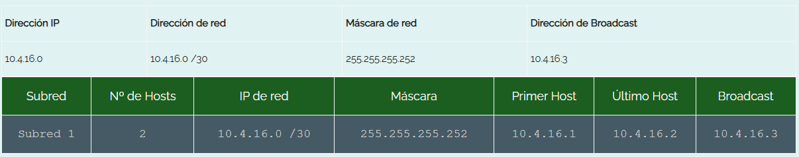

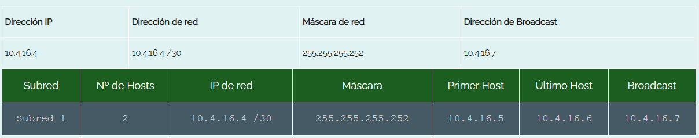

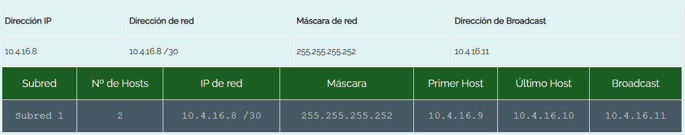

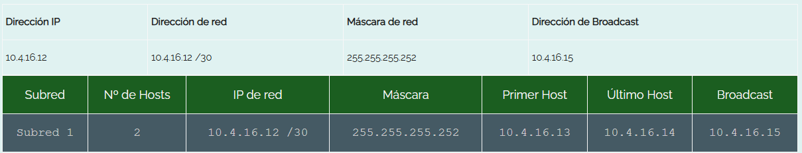

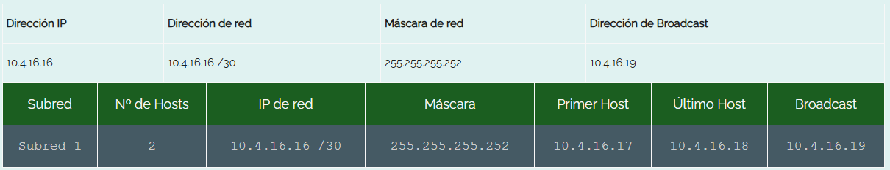

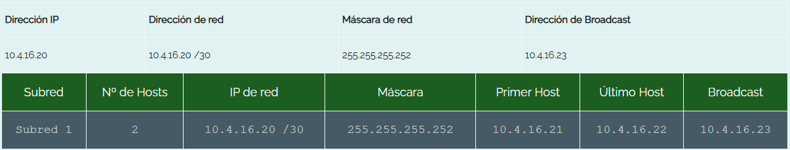

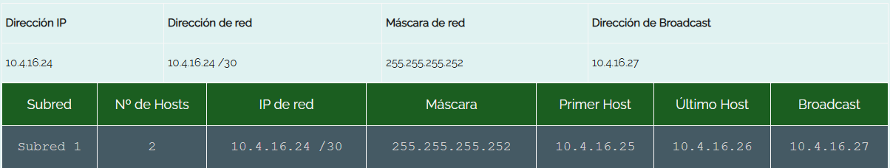

#### 2.2.1 Tabla de FLSM

| **IP de Red**  | **Máscara**     | **Wildcard** | **Primer Host** | **Último Host** | **IP Broadcast** |
| :------------- | :-------------- | :----------- | :-------------- | :-------------- | :--------------- |
| 10.4.16.0 /30  | 255.255.255.252 | 0.0.0.3      | 10.4.16.1       | 10.4.16.2       | 10.4.16.3        |
| 10.4.16.4 /30  | 255.255.255.252 | 0.0.0.3      | 10.4.16.5       | 10.4.16.6       | 10.4.16.7        |
| 10.4.16.8 /30  | 255.255.255.252 | 0.0.0.3      | 10.4.16.9       | 10.4.16.10      | 10.4.16.11       |
| 10.4.16.12 /30 | 255.255.255.252 | 0.0.0.3      | 10.4.16.13      | 10.4.16.14      | 10.4.16.15       |
| 10.4.16.16 /30 | 255.255.255.252 | 0.0.0.3      | 10.4.16.17      | 10.4.16.18      | 10.4.16.19       |
| 10.4.16.20 /30 | 255.255.255.252 | 0.0.0.3      | 10.4.16.21      | 10.4.16.22      | 10.4.16.23       |
| 10.4.16.24 /30 | 255.255.255.252 | 0.0.0.3      | 10.4.16.25      | 10.4.16.26      | 10.4.16.27       |

## 3. Configuración de edificio izquierdo

### 3.1 Multilayer Switch (DISTRIBUCIÓN) - MS-D

```bash
enable
configure terminal
hostname MS-D
no ip domain-lookup
vtp domain chapinred16
vtp mode server
vtp password cisco16
vtp version 2
vlan 16
    name VLAN_Naranja_EdificioIZQ_202307716
vlan 26
    name VLAN_Verde_EdificioIZQ_202307716
exit
spanning-tree vlan 1,16,26,56 root primary
spanning-tree mode rapid-pvst
interface range fa0/1-2
    channel-group 1 mode active
exit
interface range fa0/3-5
    channel-group 2 mode active
exit
interface range fa0/6-8
    channel-group 3 mode active
exit
interface port-channel 1
    switchport trunk encapsulation dot1q
    switchport mode trunk
exit
interface port-channel 2
    switchport trunk encapsulation dot1q
    switchport mode trunk
exit
interface port-channel 3
    switchport trunk encapsulation dot1q
    switchport mode trunk
exit
do write memory
```

### 3.2 Multilayer Switch (CORE) - MS-C

```bash
enable
configure terminal
hostname MS-C
no ip domain-lookup
vtp domain chapinred16
vtp mode client
vtp password cisco16
vtp version 2
spanning-tree mode rapid-pvst
interface range fa0/1-2
    channel-group 1 mode passive
exit
interface range fa0/3-5
    channel-group 2 mode passive
exit
interface range fa0/6-8
    channel-group 4 mode passive
exit
interface port-channel 1
    switchport trunk encapsulation dot1q
    switchport mode trunk
exit
interface port-channel 2
    switchport trunk encapsulation dot1q
    switchport mode trunk
exit
interface port-channel 4
    switchport trunk encapsulation dot1q
    switchport mode trunk
exit
do write memory
```

### 3.3 Switch (Edificio Izquierda 1) - SW-EI1

```bash
enable
configure terminal
hostname SW-EI1
no ip domain-lookup
vtp domain chapinred16
vtp mode client
vtp password cisco16
vtp version 2
spanning-tree mode rapid-pvst
interface range fa0/1-2
    channel-group 1 mode active
exit
interface port-channel 1
    switchport trunk encapsulation dot1q
    switchport mode trunk
exit
interface fa0/3
    switchport mode access
    switchport access vlan 16
exit
interface fa0/4
    switchport mode access
    switchport access vlan 26
exit
do write memory
```

### 3.4 Switch (Edificio Izquierdo 2) - SW-EI2

```bash
enable
configure terminal
hostname SW-EI2
no ip domain-lookup
vtp domain chapinred16
vtp mode client
vtp password cisco16
vtp version 2
spanning-tree mode rapid-pvst
interface range fa0/1-2
    channel-group 1 mode passive
exit
interface port-channel 1
    switchport trunk encapsulation dot1q
    switchport mode trunk
exit
interface fa0/3
    switchport mode access
    switchport access vlan 16
exit
interface fa0/4
    switchport mode access
    switchport access vlan 26
exit
do write memory
```

### 3.5 Router (Edificio Izquierdo) - R-IZQ

```bash
enable
configure terminal
hostname R-IZQ
no ip domain-lookup
vtp domain chapinred16
vtp mode client
vtp password cisco16
vtp version 2
spanning-tree mode rapid-pvst
ip routing
interface range g1/0/1-3
    channel-group 3 mode passive
exit
interface port-channel 3
    switchport trunk encapsulation dot1q
    switchport mode trunk
exit
interface range g1/0/4-6
    channel-group 4 mode active
exit
interface port-channel 4
    switchport trunk encapsulation dot1q
    switchport mode trunk
exit
interface g1/1/1
    no switchport
    ip address 10.4.16.1 255.255.255.252
    no shutdown
exit
interface g1/1/2
    no switchport
    ip address 10.4.16.5 255.255.255.252
    no shutdown
exit
interface g1/1/3
    no switchport
    ip address 10.4.16.9 255.255.255.252
    no shutdown
exit
router ospf 1
    network 10.4.16.0 0.0.0.3 area 0
    network 10.4.16.4 0.0.0.3 area 0
    network 10.4.16.8 0.0.0.3 area 0
    network 192.188.16.0 0.0.0.7 area 0
    network 192.188.16.8 0.0.0.7 area 0
exit
interface Vlan16
    ip address 192.188.16.1 255.255.255.248
    ip helper-address 10.4.16.22
    no shutdown
exit
interface Vlan26
    ip address 192.188.16.9 255.255.255.248
    ip helper-address 10.4.16.22
    no shutdown
exit
do write memory
```

## 4. Configuración de edificio derecho

### 4.1 Multilayer Switch (1) - MS-1

```bash
enable
configure terminal
hostname MS-1
no ip domain-lookup
vtp domain chapinred16
vtp mode server
vtp password cisco16
vtp version 2
vlan 36
    name VLAN_Naranja_EdificioDER_202307716
vlan 46
    name VLAN_Verde_EdificioDER_202307716
exit
spanning-tree vlan 1,36,46 root primary
spanning-tree mode rapid-pvst
interface range fa0/1-3
    channel-group 1 mode desirable
exit
interface range fa0/4-7
    channel-group 2 mode desirable
exit
interface port-channel 1
    switchport trunk encapsulation dot1q
    switchport mode trunk
exit
interface port-channel 2
    switchport trunk encapsulation dot1q
    switchport mode trunk
exit
do write memory
```

### 4.2 Multilayer Switch (2) - MS-2

```bash
enable
configure terminal
hostname MS-2
no ip domain-lookup
vtp domain chapinred16
vtp mode client
vtp password cisco16
vtp version 2
spanning-tree mode rapid-pvst
interface range fa0/1-4
    channel-group 2 mode auto
exit
interface range fa0/5-6
    channel-group 1 mode auto
exit
interface port-channel 2
    switchport trunk encapsulation dot1q
    switchport mode trunk
exit
interface port-channel 1
    switchport trunk encapsulation dot1q
    switchport mode trunk
exit
do write memory
```

### 4.3 Multilayer Switch (3) - MS-3

```bash
enable
configure terminal
hostname MS-3
no ip domain-lookup
vtp domain chapinred16
vtp mode client
vtp password cisco16
vtp version 2
spanning-tree mode rapid-pvst
interface range fa0/3-4
    channel-group 1 mode desirable
exit
interface port-channel 1
    switchport trunk encapsulation dot1q
    switchport mode trunk
exit
interface fa0/1
    switchport trunk encapsulation dot1q
    switchport mode trunk
exit
interface fa0/2
    switchport trunk encapsulation dot1q
    switchport mode trunk
exit
do write memory
```

### 4.4 Switch (Edificio Derecho 1) - SW-ED1

```bash
enable
configure terminal
hostname SW-ED1
no ip domain-lookup
vtp domain chapinred16
vtp mode client
vtp password cisco16
vtp version 2
spanning-tree mode rapid-pvst
interface fa0/1
    switchport trunk encapsulation dot1q
    switchport mode trunk
exit
interface fa0/2
    switchport mode access
    switchport access vlan 46
exit
interface fa0/3
    switchport mode access
    switchport access vlan 36
exit
do write memory
```

### 4.5 Switch (Edificio Derecho 2) - SW-ED2

```bash
enable
configure terminal
hostname SW-ED2
no ip domain-lookup
vtp domain chapinred16
vtp mode client
vtp password cisco16
vtp version 2
spanning-tree mode rapid-pvst
interface fa0/1
    switchport trunk encapsulation dot1q
    switchport mode trunk
exit
interface fa0/2
    switchport mode access
    switchport access vlan 46
exit
interface fa0/3
    switchport mode access
    switchport access vlan 36
exit
do write memory
```

### 4.6 Router (Edificio Derecho) - R-DER

```bash
enable
configure terminal
hostname R-DER
no ip domain-lookup
vtp domain chapinred16
vtp mode client
vtp password cisco16
vtp version 2
spanning-tree mode rapid-pvst
ip routing
interface range g1/0/1-3
    channel-group 1 mode auto
exit
interface port-channel 1
    switchport trunk encapsulation dot1q
    switchport mode trunk
exit
interface g1/1/1
    no switchport
    ip address 10.4.16.17 255.255.255.252
    no shutdown
exit
interface g1/1/2
    no switchport
    ip address 10.4.16.6 255.255.255.252
    no shutdown
exit
interface g1/1/3
    no switchport
    ip address 10.4.16.14 255.255.255.252
    no shutdown
exit
router ospf 1
    network 10.4.16.4 0.0.0.3 area 0
    network 10.4.16.12 0.0.0.3 area 0
    network 10.4.16.16 0.0.0.3 area 0
    network 192.188.16.16 0.0.0.7 area 0
    network 192.188.16.24 0.0.0.7 area 0
exit
interface Vlan36
    ip address 192.188.16.17 255.255.255.248
    ip helper-address 10.4.16.26
    no shutdown
exit
interface Vlan46
    ip address 192.188.16.25 255.255.255.248
    ip helper-address 10.4.16.26
    no shutdown
exit
do write memory
```

## 5. Configuración de edificio de administración

### 5.1 Router (Edificio Administración) - R-ADMIN

```bash
enable
configure terminal
hostname R-ADMIN
no ip domain-lookup
vtp domain chapinred16
vtp mode server
vtp password cisco16
vtp version 2
ip routing
vlan 56
    name VLAN_ADMIN_EdificioADMIN_202307716
exit
interface g1/0/1
    switchport mode access
    switchport access vlan 56
    spanning-tree portfast
exit
interface g1/1/1
    no switchport
    ip address 10.4.16.10 255.255.255.252
    no shutdown
exit
interface g1/1/2
    no switchport
    ip address 10.4.16.13 255.255.255.252
    no shutdown
exit
router ospf 1
    network 10.4.16.8 0.0.0.3 area 0
    network 10.4.16.12 0.0.0.3 area 0
    network 192.188.16.32 0.0.0.7 area 0
exit
interface Vlan56
    ip address 192.188.16.33 255.255.255.248
    ip helper-address 10.4.16.22
    no shutdown
exit
do write memory
```

## 6. Configuración de edificio de servidores

### 6.1 Router (Edificio Servidores) - R-SERVIDORES

```bash
enable
configure terminal
hostname R-SERVIDORES
no ip domain-lookup
vtp domain chapinred16
vtp mode server
vtp password cisco16
vtp version 2
ip routing
interface g1/1/1
    no switchport
    ip address 10.4.16.2 255.255.255.252
    no shutdown
exit
interface g1/1/2
    no switchport
    ip address 10.4.16.18 255.255.255.252
    no shutdown
exit
interface g1/0/1
    no switchport
    ip address 10.4.16.21 255.255.255.252
    no shutdown
exit
interface g1/0/2
    no switchport
    ip address 10.4.16.25 255.255.255.252
    no shutdown
exit
router ospf 1
    network 10.4.16.0 0.0.0.3 area 0
    network 10.4.16.16 0.0.0.3 area 0
    network 10.4.16.20 0.0.0.3 area 0
    network 10.4.16.24 0.0.0.3 area 0
exit
do write memory
```

### 6.2 Server (Edificio Izquierdo) - S-IZQ

IP estática del servidor:

- IP: `10.4.16.22`
- Máscara: `255.255.255.252`
- Gateway: `10.4.16.21`

Pools DHCP:

| Pool | Gateway | IP inicial | Máscara | Máx. |
| ---------------- | --------------- | --------------- | ----------------- | ---- |
| VLAN_ADMIN_ADMIN | `192.188.16.33` | `192.188.16.34` | `255.255.255.248` | 6 |
| VLAN_Naranja_IZQ | `192.188.16.1` | `192.188.16.2` | `255.255.255.248` | 6 |
| VLAN_Verde_IZQ | `192.188.16.9` | `192.188.16.10` | `255.255.255.248` | 6 |

DNS para ambos pools: `0.0.0.0`.

### 6.3 Server (Edificio Derecho) - S-DER

IP estática del servidor:

- IP: `10.4.16.26`
- Máscara: `255.255.255.252`
- Gateway: `10.4.16.25`

Pools DHCP:

| Pool | Gateway | IP inicial | Máscara | Máx. |
| ---------------- | --------------- | --------------- | ----------------- | ---- |
| VLAN_Naranja_DER | `192.188.16.17` | `192.188.16.18` | `255.255.255.248` | 6 |
| VLAN_Verde_DER | `192.188.16.25` | `192.188.16.26` | `255.255.255.248` | 6 |

DNS para ambos pools: `0.0.0.0`.

## 7. Configuración de ACLs

### 7.1 ACL edificio izquierdo

```bash
enable
configure terminal

ip access-list extended ACL_NARANJA_IZQ
    ! Permitir DHCP para no romper el delay
    permit udp any any eq 67
    permit udp any any eq 68
    ! Permitir comunicacion con VLAN Naranja del edificio derecho
    permit ip 192.188.16.0 0.0.0.7 192.188.16.16 0.0.0.7
    ! Permitir retorno de sesiones iniciadas por ADMIN
    permit tcp 192.188.16.0 0.0.0.7 192.188.16.32 0.0.0.7 established
    permit icmp 192.188.16.0 0.0.0.7 192.188.16.32 0.0.0.7 echo-reply
    ! Bloquear comunicacion hacia VLANs Verdes
    deny ip 192.188.16.0 0.0.0.7 192.188.16.8 0.0.0.7
    deny ip 192.188.16.0 0.0.0.7 192.188.16.24 0.0.0.7
    ! Bloquear inicio de comunicacion hacia VLAN ADMIN
    deny ip 192.188.16.0 0.0.0.7 192.188.16.32 0.0.0.7
exit

ip access-list extended ACL_VERDE_IZQ
    ! Permitir DHCP para no romper el relay
    permit udp any any eq 67
    permit udp any any eq 68
    ! Permitir comunicacion con VLAN Verde del edificio derecho
    permit ip 192.188.16.8 0.0.0.7 192.188.16.24 0.0.0.7
    ! Permitir retorno de sesiones iniciadas por ADMIN
    permit tcp 192.188.16.8 0.0.0.7 192.188.16.32 0.0.0.7 established
    permit icmp 192.188.16.8 0.0.0.7 192.188.16.32 0.0.0.7 echo-reply
    ! Bloquear comunicacion hacia VLANs Naranjas
    deny ip 192.188.16.8 0.0.0.7 192.188.16.0 0.0.0.7
    deny ip 192.188.16.8 0.0.0.7 192.188.16.16 0.0.0.7
    ! Bloquear inicio de comunicacion hacia VLAN ADMIN
    deny ip 192.188.16.8 0.0.0.7 192.188.16.32 0.0.0.7
exit

interface Vlan16
    ip access-group ACL_NARANJA_IZQ in
exit
interface Vlan26
    ip access-group ACL_VERDE_IZQ in
exit
do write memory
```

### 7.2 ACL edificio derecho

```bash
enable
configure terminal

ip access-list extended ACL_NARANJA_DER
    ! Permitir DHCP para no romper el relay
    permit udp any any eq 67
    permit udp any any eq 68
    ! Permitir comunicacion con VLAN Naranja del edificio izquierdo
    permit ip 192.188.16.16 0.0.0.7 192.188.16.0 0.0.0.7
    ! Permitir retorno de sesiones iniciadas por ADMIN
    permit tcp 192.188.16.16 0.0.0.7 192.188.16.32 0.0.0.7 established
    permit icmp 192.188.16.16 0.0.0.7 192.188.16.32 0.0.0.7 echo-reply
    ! Bloquear comunicacion hacia VLANs Verdes
    deny ip 192.188.16.16 0.0.0.7 192.188.16.8 0.0.0.7
    deny ip 192.188.16.16 0.0.0.7 192.188.16.24 0.0.0.7
    ! Bloquear inicio de comunicacion hacia VLAN ADMIN
    deny ip 192.188.16.16 0.0.0.7 192.188.16.32 0.0.0.7
exit

ip access-list extended ACL_VERDE_DER
    ! Permitir DHCP para no romper el relay
    permit udp any any eq 67
    permit udp any any eq 68
    ! Permitir comunicacion con VLAN Verde del edificio izquierdo
    permit ip 192.188.16.24 0.0.0.7 192.188.16.8 0.0.0.7
    ! Permitir retorno de sesiones iniciadas por ADMIN
    permit tcp 192.188.16.24 0.0.0.7 192.188.16.32 0.0.0.7 established
    permit icmp 192.188.16.24 0.0.0.7 192.188.16.32 0.0.0.7 echo-reply
    ! Bloquear comunicacion hacia VLANs Naranjas
    deny ip 192.188.16.24 0.0.0.7 192.188.16.0 0.0.0.7
    deny ip 192.188.16.24 0.0.0.7 192.188.16.16 0.0.0.7
    ! Bloquear inicio de comunicacion hacia VLAN ADMIN
    deny ip 192.188.16.24 0.0.0.7 192.188.16.32 0.0.0.7
exit

interface Vlan36
    ip access-group ACL_NARANJA_DER in
exit
interface Vlan46
    ip access-group ACL_VERDE_DER in
exit
do write memory
```

### 7.3 ACL edificio ADMIN

```bash
enable
configure terminal

ip access-list extended ACL_ADMIN
    ! VLAN ADMIN no tiene restricciones de salida, acceso completo
    permit udp any any eq 67
    permit udp any any eq 68
    permit ip 192.188.16.32 0.0.0.7 any
exit

interface Vlan56
    ip access-group ACL_ADMIN in
exit
do write memory
```

## 8. Pruebas

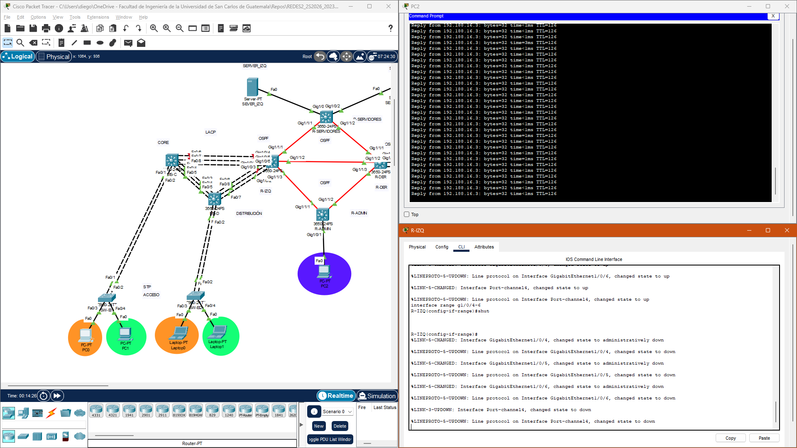

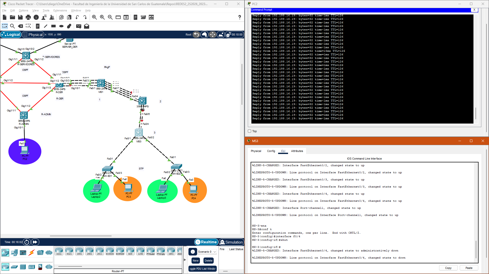

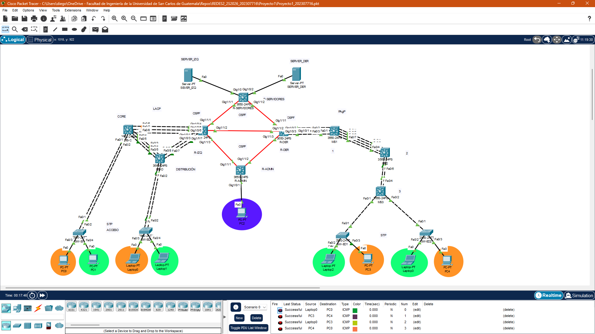

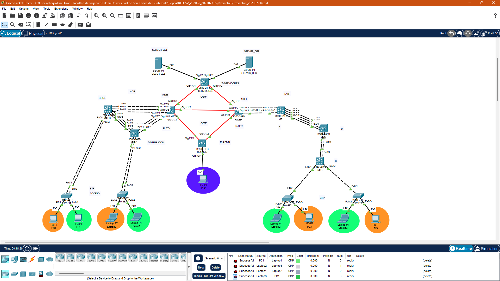

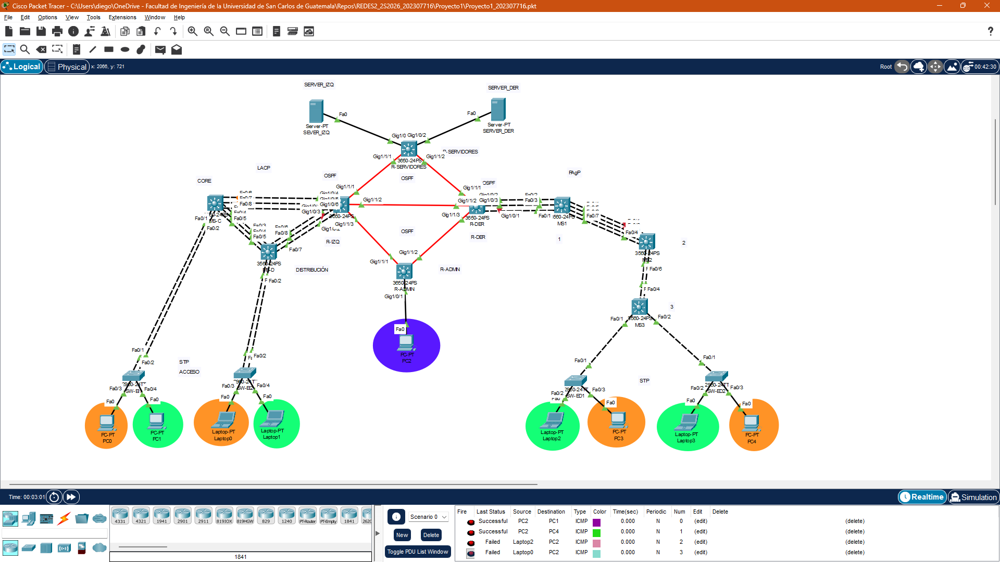

## 9. Resumen de Comandos

| Comando                              | Propósito                                        |
| ------------------------------------ | ------------------------------------------------ |
| `show vlan brief`                    | Ver VLANS y sus puertos.                         |
| `show interfaces trunk`              | Verificar los enlaces trunk.                     |
| `show spanning-tree summary`         | Ver el modo STP configurado.                     |
| `show spanning-tree blockedports`    | Identificar los puertos bloqueados.              |
| `show interfaces status`             | Identificar puertos en `err-disabled`.           |
| `show ip protocols`                  | Ver los protocolos y redes anunciadas.           |
| `show ip ospf neighbor`              | Verificar vecinos OSPF.                          |
| `show ip route`                      | Consultar toda la tabla de enrutamiento.         |
| `show ip route ospf`                 | Mostrar únicamente rutas OSPF.                   |
| `show running-config`                | Revisar la configuración activa.                 |
| `show etherchannel summary`          | Ver estado de los EtherChannels.                 |
| `show ip interface brief`            | Ver estado y direcciones IP de interfaces.       |
| `show access-lists`                  | Mostrar las listas de control de acceso.         |
| `show vtp status`                    | Ver estado, dominio y modo de VTP.               |
| `ping`                               | Comprobar conectividad.                          |
